# 8-bit Counter: RTL to GDSII on a 45 nm GPDK

A complete digital back-end flow on an 8-bit counter with asynchronous active-low reset: functional simulation with coverage, logic synthesis, scan insertion (DFT), ATPG, place and route, signoff checks, power/IR-drop analysis and GDSII stream-out, using the Cadence tool suite on the 45 nm GPDK.

> **Project note.** This is a course lab built on the Cadence *RTL to GDSII* course database. The PDK, library and LEF/tech files are **not** included in this repository because of licensing; to reproduce the runs, place your own licensed GPDK045 files in `lib/`, `lef/`, `captable/` and `QRC_Tech/`.

## Contents
1. [Flow overview](#1-flow-overview)
2. [Tools](#2-tools)
3. [RTL design and simulation](#3-rtl-design-and-simulation)
4. [Timing constraints](#4-timing-constraints)
5. [Logic synthesis (Genus)](#5-logic-synthesis-genus)
6. [DFT: scan insertion](#6-dft-scan-insertion)
7. [ATPG (Modus)](#7-atpg-modus)
8. [Logic equivalence check (Conformal)](#8-logic-equivalence-check-conformal)
9. [Physical design (Innovus)](#9-physical-design-innovus)
10. [Signoff checks and power](#10-signoff-checks-and-power)
11. [Final layout and GDSII](#11-final-layout-and-gdsii)
12. [Results summary](#12-results-summary)
13. [Known issues and next steps](#13-known-issues-and-next-steps)
14. [Repository structure](#14-repository-structure)
15. [How to reproduce](#15-how-to-reproduce)
16. [Credits and license](#16-credits-and-license)

## 1. Flow overview
  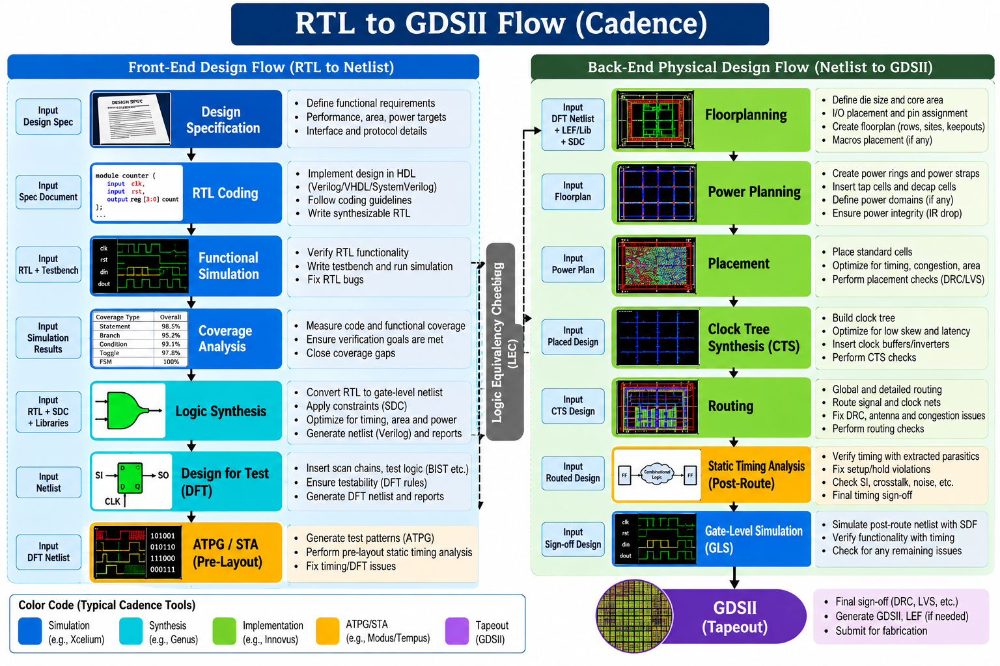

  *Overall Cadence RTL-to-GDSII flow. Results from my runs are in the sections below.*


## 2. Tools
| Stage | Tool | Version |
|---|---|---|
| Simulation and coverage | Cadence Xcelium, SimVision, IMC | 22.09 |
| Synthesis and DFT | Cadence Genus | 21.14 |
| ATPG | Cadence Modus | 22.10 |
| Equivalence check | Cadence Conformal | 22.2 (per course README) |
| Place and route | Cadence Innovus | 21.15 |
| Power / IR drop | Voltus (inside Innovus) | 21.15 |

Technology: 45 nm GPDK (`gpdk045`), 11 metal layers, slow (setup) and fast (hold) library corners.

## 3. RTL design and simulation
The design is an 8-bit up-counter with asynchronous active-low reset ([`rtl/counter.v`](rtl/counter.v)).

```verilog
module counter(clk,rst,count);
input clk,rst;
output reg [7:0] count;
always@(posedge clk or negedge rst)
begin
  if(!rst) count=0;
  else     count=count+1;
end
endmodule
```

The testbench ([`tb/counter_test.v`](tb/counter_test.v)) generates a 10 ns clock (toggle every 5 ns), holds `rst` low for 10 ns, then releases it. The run used `xrun -access +rwc -coverage all -gui` ([`tb/xrun_simulation.log`](tb/xrun_simulation.log)).

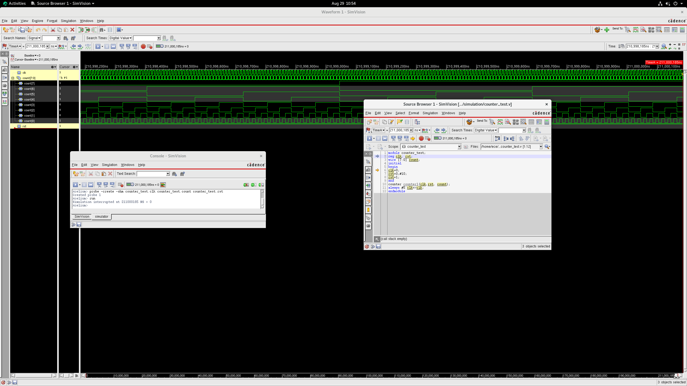

<!-- TODO (author): add IMC coverage screenshot as images/11_imc_coverage.png and show it here:
 -->

## 4. Timing constraints
[`constraints/constraints_top.sdc`](constraints/constraints_top.sdc)

| Constraint | Value |
|---|---|
| Clock `clk` | 10 ns period (100 MHz), 50% duty |
| Clock transition | 0.1 ns (rise and fall) |
| Clock uncertainty | 0.01 ns |
| Input delay (`rst`) | 1.0 ns |
| Output delay (`count`) | 1.0 ns |

## 5. Logic synthesis (Genus)
Scripts: [`synthesis/genus_script.tcl`](synthesis/genus_script.tcl) (generic, map and optimize at medium effort, slow library, 0.9 V / 125 C). Reports are in [`synthesis/reports/`](synthesis/reports/) and the netlist in [`synthesis/outputs/counter_netlist.v`](synthesis/outputs/counter_netlist.v).

| Metric | Result |
|---|---|
| Leaf cells | 21 (8 sequential, 13 combinational) |
| Cell area | 72.504 um^2 |
| Critical path slack (setup) | +8684 ps (no violating paths) |
| Total power | about 2.77 uW (register 87.2%, logic 8.1%, clock 4.7%) |

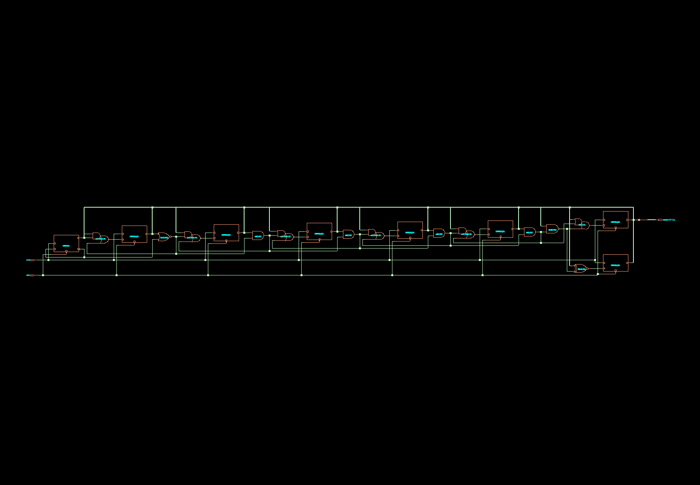

## 6. DFT: scan insertion
Script: [`synthesis/genus_dft_script.tcl`](synthesis/genus_dft_script.tcl). Muxed-scan style, one scan chain (`top_chain`), active-high shift enable `SE`, new ports `scan_in` and `scan_out`. All 8 flip-flops are replaced by scan flops (`SDFFRHQX1`) chained from `count[0]` to `count[7]`; `scan_out` is taken from `count[7]`.

Outputs: [`counter_netlist_dft.v`](synthesis/outputs/counter_netlist_dft.v), [`counter_sdc_dft.sdc`](synthesis/outputs/counter_sdc_dft.sdc), [`counter_scanDEF.scandef`](synthesis/outputs/counter_scanDEF.scandef).

| Before DFT | After DFT |
|---|---|
|  | 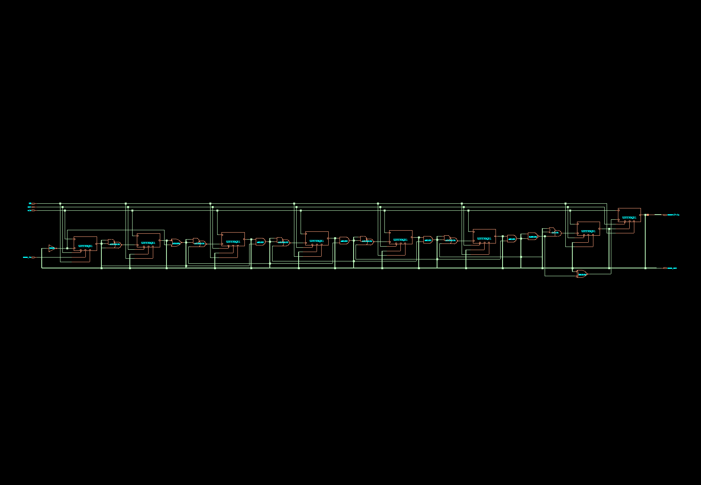 |

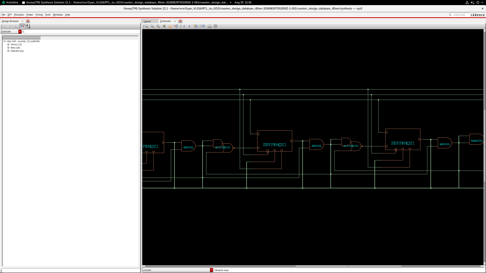

## 7. ATPG (Modus)
Script: [`dft_atpg/runmodus.atpg.tcl`](dft_atpg/runmodus.atpg.tcl); metrics: [`dft_atpg/modus_metrics`](dft_atpg/modus_metrics). Test mode `FULLSCAN`.

| Experiment | Tests | Static (stuck-at) test coverage |
|---|---|---|
| Scan-chain tests only | 1 | 57.04% |
| Logic tests (+ scan) | 12 (11 logic + 1 scan) | **100%** (398 of 398 faults) |

<!-- TODO (author): add a Modus terminal/GUI screenshot as images/12_modus_atpg.png and show it here -->

## 8. Logic equivalence check (Conformal)
Script: [`dft_atpg/conformal_counter.do`](dft_atpg/conformal_counter.do). It compares the RTL (golden) against the scan netlist `counter_netlist_dft.v` (revised) with `SE` constrained to 0 and the scan ports ignored.

<!-- TODO (author): re-run the script, then add the result (e.g. "all compared points equivalent") and a screenshot images/13_conformal_result.png -->

## 9. Physical design (Innovus)
Command log: [`physical_design/run_pnr.tcl`](physical_design/run_pnr.tcl). Multi-mode multi-corner setup in [`counter.view`](physical_design/counter.view): setup analysed in the slow corner, hold in the fast corner, OCV analysis enabled.

### 9.1 Floorplan
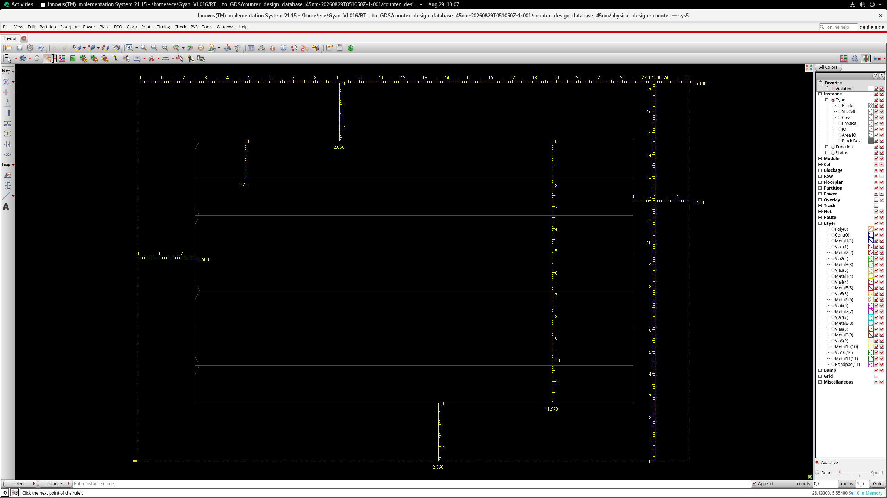

### 9.2 Power planning
Core rings on Metal11 (top/bottom) and Metal10 (left/right), 0.7 um wide; vertical Metal10 stripes (0.3 um wide, 5 um set-to-set distance); standard-cell rails connected with `route_special`.

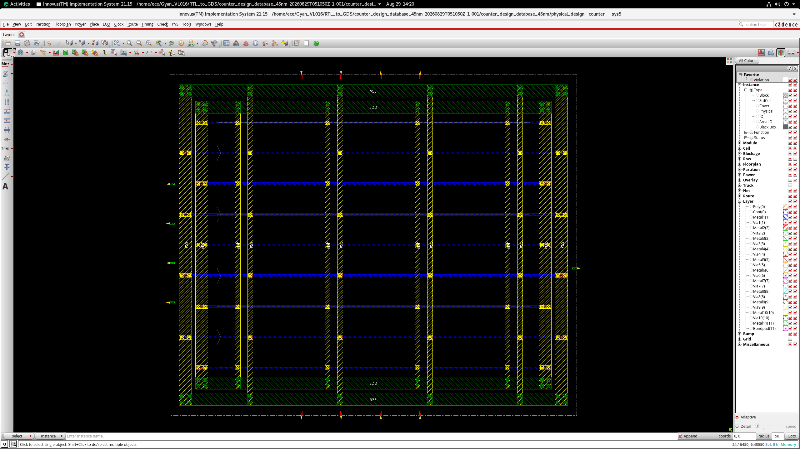

### 9.3 Placement
`place_opt_design`, with scan chain reordering enabled from the scan DEF.

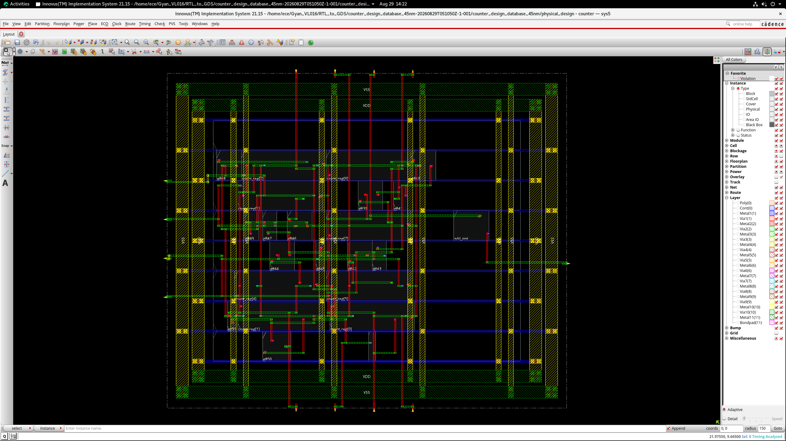

### 9.4 Clock tree synthesis
`create_clock_tree_spec` and `ccopt_design`.

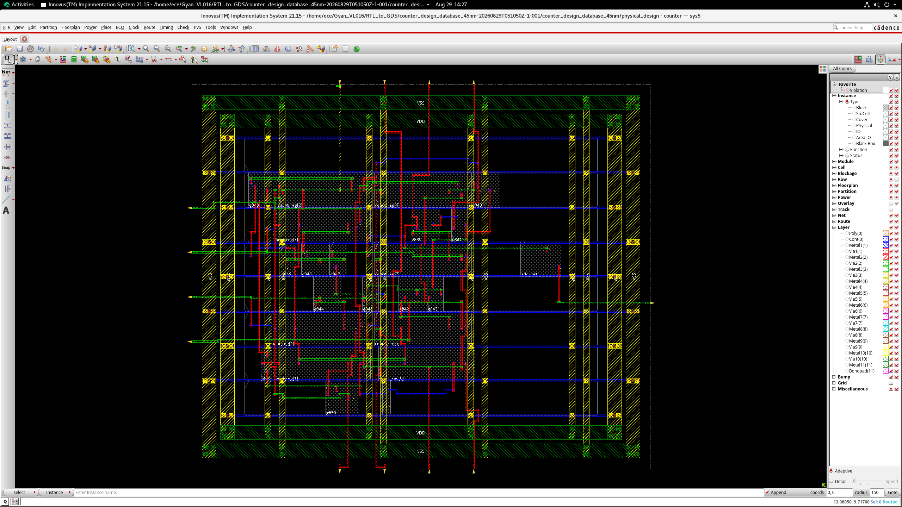

### 9.5 Routing
`route_design -global_detail`, timing-driven and SI-driven, Metal1 to Metal11, followed by RC extraction.

### 9.6 Timing across the flow
Reports: [`physical_design/reports/`](physical_design/reports/)

| Stage | Setup WNS | Setup TNS | Violating paths |
|---|---|---|---|
| Post-placement (pre-CTS) | +8.358 ns | 0.000 | 0 |
| Post-CTS | +8.401 ns | 0.000 | 0 |
| Post-route | +8.381 ns | 0.000 | 0 |
| **Post-route hold** | **-0.093 ns** | **-0.985 ns** | **17** (see section 13) |

Placement density is 39.799% with 0% routing overflow; there are no max-cap, max-transition or max-fanout violations.

> **Input netlist note.** This Innovus run read the course-provided netlist [`physical_design/counter_netlist.v`](physical_design/counter_netlist.v) (which includes a `TBUFX1` buffer on `scan_out`), together with the course `counter_sdc.sdc` and `counter.scandef`. It is not the netlist produced by the synthesis step in section 6.

## 10. Signoff checks and power
| Check | Result | File |
|---|---|---|
| DRC | No violations | [`signoff/counter.drc.rpt`](signoff/counter.drc.rpt) |
| Connectivity | No problems or warnings | [`signoff/counter.conn.rpt`](signoff/counter.conn.rpt) |
| Static IR drop (VDD, 0.9 V) | 0 violations; worst node 0.89999 V (about 9 uV drop) | [`signoff/voltus_VDD_main.rpt`](signoff/voltus_VDD_main.rpt) |
| Current density (EM) | 0 violations | same report |

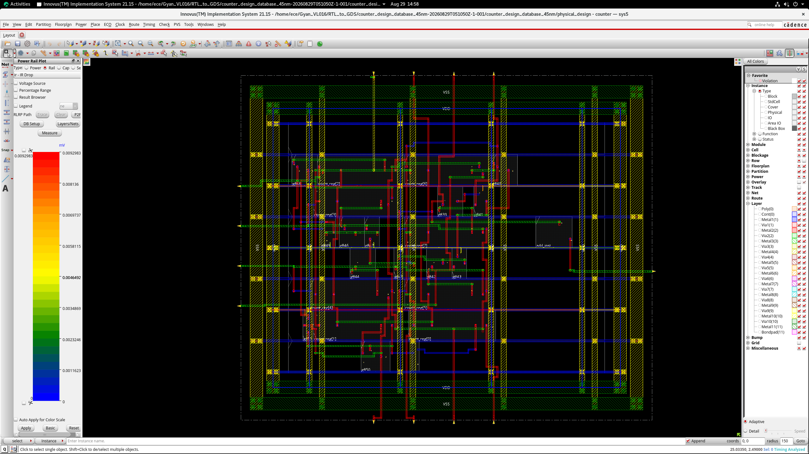

Power estimates differ by tool and assumptions: Genus reports about 2.77 uW (synthesis netlist), while Innovus `report_power` gives about 5.19 uW for the P&R netlist at 0.2 input activity, slow corner, 125 C.

## 11. Final layout and GDSII
Fillers are added (`add_fillers`) and the design is streamed out with `write_stream counter -lib_name DesignLib -unit 2000 -mode all`.

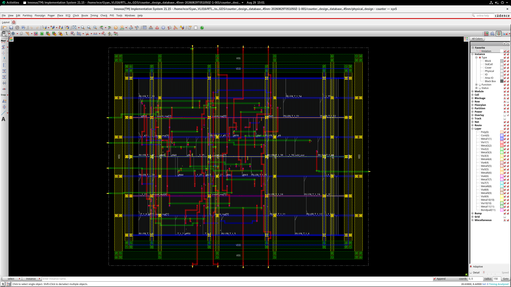

## 12. Results summary
| Metric | Result |
|---|---|
| Function | 8-bit up-counter, async active-low reset |
| Clock | 10 ns (100 MHz) |
| Synthesis area | 72.504 um^2 (21 cells) |
| Synthesis setup slack | +8684 ps |
| DFT | 1 scan chain, 8 scan flops |
| ATPG static coverage | 100% (398 faults) |
| Post-route setup WNS | +8.381 ns |
| Post-route hold WNS | -0.093 ns (open, see below) |
| Placement density | 39.799% |
| DRC / connectivity | clean / clean |
| Static IR drop violations | 0 |

## 13. Known issues and next steps
- **Hold violations after routing** (17 paths, WNS -0.093 ns). Plan: run `opt_design -post_route -hold`, then `time_design -post_route -hold` and update section 9.6.
- **Run P&R on the self-synthesized netlist** (`counter_netlist_dft.v`, `counter_sdc_dft.sdc`, `counter_scanDEF.scandef`) so the whole flow is end-to-end.
- **RTL style:** use non-blocking assignments (`<=`) in the clocked block.
- **Further signoff:** independent STA and parasitic extraction (Tempus, Quantus) and physical verification (DRC/LVS) on the GDSII.

## 14. Repository structure
```
.
├── README.md
├── LICENSE
├── .gitignore
├── rtl/                    counter.v
├── tb/                     counter_test.v, xrun_simulation.log
├── constraints/            constraints_top.sdc
├── synthesis/
│   ├── genus_script.tcl, genus_dft_script.tcl
│   ├── reports/            QoR, area, power, timing
│   └── outputs/            netlists, SDC, scan DEF
├── dft_atpg/               runmodus.atpg.tcl, modus_metrics, conformal_counter.do
├── physical_design/        run_pnr.tcl, counter.view, pins.io, power.tcl,
│   │                       counter_netlist.v, counter_sdc.sdc, counter.scandef
│   └── reports/            timing summaries per stage
├── signoff/                DRC, connectivity, Voltus IR-drop report
└── images/                 tool screenshots
```

## 15. How to reproduce
Requires licensed Cadence tools and the 45 nm GPDK (not included). Place the PDK files in `lib/`, `lef/`, `captable/`, `QRC_Tech/` next to the folders above, as the scripts expect.
```bash
# Simulation
xrun rtl/counter.v tb/counter_test.v -access +rwc -coverage all -gui
# Synthesis and DFT
cd synthesis && genus -f genus_script.tcl && genus -f genus_dft_script.tcl
# ATPG
# ATPG: run dft_atpg/runmodus.atpg.tcl in Modus (it expects the Genus-generated test_scripts/ files)
# Place and route: use physical_design/run_pnr.tcl as the command reference in Innovus
```

## 16. Credits
Completed as part of the Cadence RTL-to-GDSII course lab. The course material, PDK and lab manual belong to Cadence and are not included. All results and screenshots are from my own runs.
